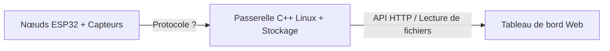

# Projet réseau de capteurs ESP32

Réseau de capteurs connectés : des nœuds ESP32 mesurent leur environnement
et envoient leurs données à une passerelle C++ sous Linux, qui les stocke
et les affiche sur un tableau de bord web.

> 🚧 Projet en cours de développement — dernière mise à jour : 29/10/2026

## Objectifs
- Mettre en pratique l'informatique embarquée vue en cours (C/C++, communication, systèmes)
- Concevoir une architecture complète : capteur → passerelle → affichage
- Documenter et versionner le projet comme en milieu professionnel

## Architecture prévue


## Matériel
- 2 ESP32
- 2 Capteurs BME280 (température, humidité, pression)
- 1 Capteur BH1750 (luminosité)

## Avancement

### 📦 Préparation & Environnement
- [x] Choix du matériel et commande
- [ ] Assemblage matériel et préparation des composants (soudures, connectique)
- [x] Initialisation du projet PlatformIO et structure des dossiers
- [x] Premier "Hello World" (Build réussi et téléversement sur l'ESP32)
- [x] Clignotement de la LED interne (*Blink*) et affichage de logs sur le moniteur série

### 🔌 Acquisition de Données (I2C)
- [ ] Scan du bus I2C (Détection des adresses physiques des capteurs)
- [ ] Lecture et affichage des données brutes du BME280 (Température, Humidité, Pression)
- [ ] Lecture et affichage des données brutes du BH1750 (Luminosité)
- [ ] Création d'une tâche/boucle propre pour lire les deux capteurs périodiquement

### 📡 Communication & Réseau
- [ ] Choix et spécification du protocole réseau (MQTT, HTTP, Sockets TCP/UDP...)
- [ ] Connexion réussie de l'ESP32 au réseau Wi-Fi local
- [ ] Envoi d'un message de test basique via le protocole choisi
- [ ] Sérialisation des vraies données des capteurs

### 🖥️ Passerelle C++ (Linux)
- [ ] Initialisation du projet C++ sous Linux (Makefile ou CMake)
- [ ] Écoute réseau et réception du message de test de l'ESP32
- [ ] Parsing (décodage) des données reçues des capteurs
- [ ] Stockage des données

### 📊 Tableau de bord Web
- [ ] Structure HTML/CSS de base de l'interface
- [ ] Récupération des données depuis la passerelle
- [ ] Affichage des données en temps réel (graphiques avec Chart.js ou similaire)

## Structure du projet
```text
esp32-sensor-network/
├── dashboard/             # Code de l'interface web (à venir)
├── firmware/              # Code embarqué de l'ESP32 (actuel : programme de test | à venir : capteurs BME280/BH1750)
├── gateway/               # Code de la passerelle C++ sous Linux (à venir)
├── .gitignore             # Fichiers à ignorer par Git
├── LICENSE                # Licence du projet
└── README.md              # Ce fichier
```

## Installation & Lancement

### Prérequis requis
* **Pour la compilation :**
  * Git (pour cloner le dépôt)
  * VS Code avec l'extension PlatformIO
  * Une connexion internet (lors du premier build pour télécharger la chaîne d'outils ESP-IDF)
* **Pour le téléversement (Flash) :**
  * Pilote USB-Série (ex: CP210x ou CH340 selon la carte, requis sous Windows)

> [!WARNING]
> Les instructions de déploiement et de flashage ne sont pas encore disponibles.

## Auteur
Luc Terrier — étudiant ingénieur GI, UTC